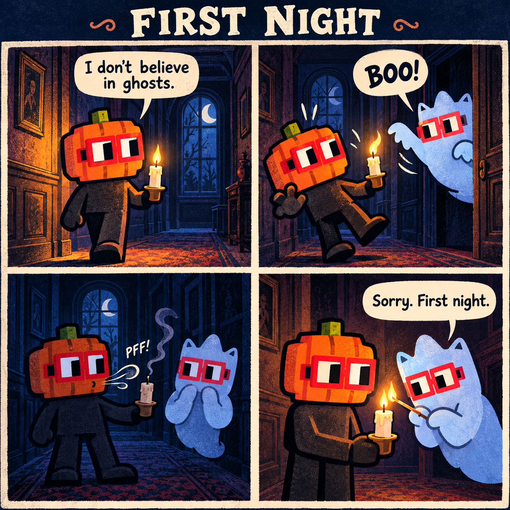

# First Night

An original four-panel Halloween comic submitted for [poidh CC0 Halloween](https://poidh.xyz/base/bounty/1500).

## Story

1. Pumpkin Noun: "I don't believe in ghosts."
2. Ghost Noun: "BOO!"
3. The startled pumpkin accidentally blows out the candle: "PFF!"
4. The embarrassed ghost relights it: "Sorry. First night."

The scare goes wrong, and a small act of kindness becomes the punchline. The title refers to the ghost's first night on the job.

## Characters and source material

Both characters are adaptations of the CC0 Nouns collection. Only Pumpkin Noun and Ghost Noun appear; both wear red square Noggles.

- [Official Nouns brand and CC0 statement](https://nouns.wtf/brand)
- [Official pumpkin-head source](https://raw.githubusercontent.com/nounsDAO/nouns-monorepo/master/packages/nouns-assets/images/v0/3-heads/head-pumpkin.png)
- [Official ghost-head source](https://raw.githubusercontent.com/nounsDAO/nouns-monorepo/master/packages/nouns-assets/images/v0/3-heads/head-ghost-B.png)
- [Official red Noggles source](https://raw.githubusercontent.com/nounsDAO/nouns-monorepo/master/packages/nouns-assets/images/v0/4-glasses/glasses-square-red.png)

The source assets were downloaded and inspected before production. The story, dialogue, setting and compositions were created for this entry. The finished raster illustration was generated with AI using those official CC0 assets as character references. AI-made entries are explicitly permitted by this bounty. The production prompt is included in this repository.

This is not an official Nouns release, and no endorsement is claimed. No Nouns NFT ownership is claimed.

## Public-domain dedication

To the extent possible under law, the contributor dedicates this comic, its original story, dialogue and accompanying original material to the public domain under **CC0 1.0 Universal**, waiving copyright and related rights held in that material. Every depicted character is based on the CC0 Nouns collection. This dedication does not assert rights over material already in the public domain, and does not imply any additional copyright in AI-generated material.

- [CC0 1.0 deed](https://creativecommons.org/publicdomain/zero/1.0/)
- [CC0 1.0 legal code](https://creativecommons.org/publicdomain/zero/1.0/legalcode)

## Entry status

Published by GitHub account `zdfgu113` for the authorized wallet `0x676FFb6D1a95c295e62daBb18F60e0F8CfCFdCe4`. This is one entry in a competition. Publication and submission are not selection or payment; no reward is guaranteed.
